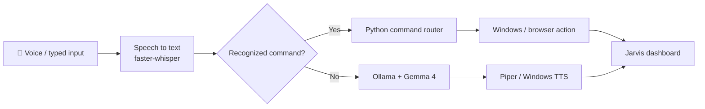

<div align="center">

# JARVIS LOCAL AI

### A voice-controlled Windows assistant, built with Python and local AI.

**Talk to your computer. Open apps. Ask questions. See the whole conversation unfold in a custom HUD.**

[](https://www.python.org/downloads/)
[](docs/INSTALL_WINDOWS.md)
[](docs/ARCHITECTURE.md)
[](RELEASE_READINESS.md)

**[Get started](#quick-start)** · **[See how it works](#how-it-works)** · **[Try commands](#what-can-jarvis-do)** · **[Security](docs/SECURITY.md)** · **[Watch Tabitha Dev](https://www.youtube.com/@tabitha-dev)**


<sub>Actual cropped frame from the creator's running Windows Jarvis interface. Not a simulated installation or proof of a disconnected-network test.</sub>

</div>

> [!IMPORTANT]
> **Development preview, not a verified public release.** The source and tests are under review. A complete clean-Windows installation, live microphone test and third-party model/license review are still required. Please read [Release readiness](RELEASE_READINESS.md) before installing or distributing. The repository is currently private.

## Why I built this

I wanted a computer assistant that felt personal and practical: say what you need, watch it respond, and learn how each part works. Jarvis combines a locally running language model with Python commands and a browser-based interface. This is an educational, fan-inspired project by [Tabitha Dev](https://code.tabitha.dev), built to be understood and improved, not a Marvel product.

## What can Jarvis do?

| Feature | How it works |
| :-- | :-- |
| 🎙️ **Voice and typing** | Wake word, push-to-talk, or type directly in the HUD. |
| 🧠 **Local AI responses** | Ollama runs the configured Gemma model on your computer after downloading it. No cloud AI API key required. |
| 🖥️ **Windows actions** | Open installed apps, approved shortcuts and folders; control volume and playback. |
| 🌐 **Browser shortcuts** | Open websites and start searches. **These activities need internet access.** |
| ✨ **Live dashboard** | Cyan/amber/white interface states, current transcript and quick commands. |
| 🛡️ **Local protections** | Loopback-only HUD, per-run command/event-stream tokens, origin checks and shell-free app launching. [Limitations](docs/SECURITY.md) apply. |

### A few example commands

```text
"Hey Jarvis, what time is it?"
"Open Chrome"
"Open YouTube"
"Open Chrome and YouTube"
"Search YouTube for Python tutorials"
"Turn the volume up"
"What can you do?"
```

These commands are **implemented in the source**; not every one has been verified in a fresh Windows installation. The published creator video includes authentic footage and a separately labeled simulated setup walkthrough.

## How it works



The wake-word path starts with **openWakeWord**. The commands and conversational AI take different routes, and the HUD tracks events from the local Python server. For files and actual component boundaries, see [Architecture](docs/ARCHITECTURE.md).

## Quick start

**Requirements:** Windows 10/11, Python 3.12 (or installer access via `winget`), a working microphone for voice mode, and internet during initial downloads. 16 GB RAM recommended; CPU-only operation is supported but may be slower. Disk space varies by model and downloads.

> [!CAUTION]
> This automated setup is still awaiting independent Windows validation. **Review a downloaded script before executing it**, and do not blindly bypass SmartScreen or other operating-system warnings.

1. [Review the Windows setup guide](docs/INSTALL_WINDOWS.md) and [third-party licenses](THIRD_PARTY_NOTICES.md).
2. Download the source ZIP only **after the first release is announced**, or clone this repository if you are a developer reviewing it.
3. Inspect `setup.bat`, then run it on a **test Windows machine** to install the listed tools and models. The revised installer stops on detected failures rather than claiming success.
4. Run `run_tests.bat` to exercise the mocked command/UI unit tests.
5. After verifying setup, run `run_jarvis.bat` or choose a terminal mode:

```powershell
.\.venv\Scripts\python.exe jarvis.py --text   # type instead of using a microphone
.\.venv\Scripts\python.exe jarvis.py --ptt    # press Enter to speak
.\.venv\Scripts\python.exe jarvis.py --no-ui  # console without dashboard
```

**Want the details?** [Windows installation guide →](docs/INSTALL_WINDOWS.md)

## Personalize your assistant

The `commands.example.json` file is a starter template. Setup makes a personal `commands.json` copy; **that file is ignored by Git**.

```json
{
  "browser": "chrome",
  "apps": {"notes": "notepad"},
  "websites": {"my portfolio": "https://example.com"},
  "folders": {"projects": "C:\\Code"}
}
```

Edit the names, apps, folders, and website addresses to suit your computer. Edit `USER_NAME`, `OLLAMA_MODEL`, and audio preferences near the top of `jarvis.py`. For colors, edit the CSS variables in `ui.html`. Never commit a personalized config or private file.

## Project files

```text
jarvis.py              Python assistant, Ollama, audio and local HUD server
commands.py            Windows, URL and shortcut command routing
ui.html                Responsive HUD (HTML, CSS, JavaScript)
commands.example.json  Safe starter preferences
setup.bat               Windows-only setup with failure checks
run_jarvis.bat          Start the assistant
run_tests.bat           Run isolated tests
requirements.txt       Python dependencies
tests/                 Mocked command and local HTTP regression tests
docs/                  Install, architecture, security and troubleshooting
THIRD_PARTY_NOTICES.md Libraries, models and voice licensing
RELEASE_READINESS.md   Outstanding publishing checks
```

## Testing and transparency

Run `python -m unittest discover tests -v` after installing the necessary test dependencies. The suite **mocks** application launches and audio actions; it does not prove that Chrome opened, that wake-word recognition worked through a physical microphone, or that the model installed successfully. See the [release checklist](RELEASE_READINESS.md) for the real Windows validation still needed.

**Local inference ≠ every action is offline.** Model inference is intended to run locally after downloading model weights; opening web pages and searching are online actions. A recorded HUD status message is not proof that a live network-disconnection test occurred.

## Useful links

[Windows setup](docs/INSTALL_WINDOWS.md) · [Architecture](docs/ARCHITECTURE.md) · [Troubleshooting](docs/TROUBLESHOOTING.md) · [Security](docs/SECURITY.md) · [Third-party notices](THIRD_PARTY_NOTICES.md) · [Release checklist](RELEASE_READINESS.md) · [Contributing](CONTRIBUTING.md)

## Credits and licensing

Made by **[Tabitha Dev](https://code.tabitha.dev)** · [GitHub](https://github.com/tabitha-dev) · [YouTube tutorials](https://www.youtube.com/@tabitha-dev)

**Project code license:** *not yet selected*. No general reuse or redistribution permission is asserted until the creator chooses a license and publishes it. Model weights, voices and dependencies belong to their respective owners and follow their **separate** licenses; see [Third-party notices](THIRD_PARTY_NOTICES.md). OpenWakeWord's pretrained models may carry noncommercial limits. No Marvel artwork, voice or footage is distributed, and this project is not affiliated with Marvel or Disney.

<div align="center">

**Software Engineering, Made Simple.**

*Learn it. Run it. Understand it.*

</div>
