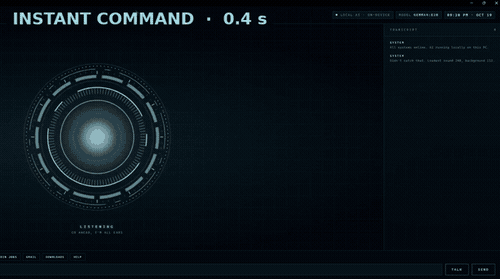
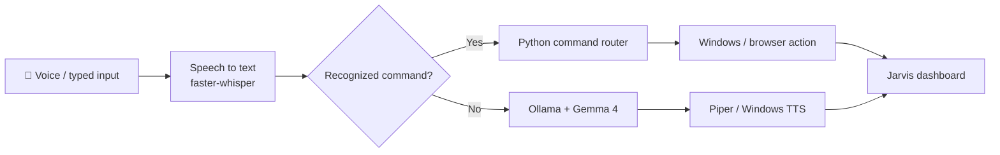

<div align="center">

# JARVIS LOCAL AI

### A voice-controlled Windows assistant, built with Python and local AI.

**Talk to your computer. Open apps. Ask questions. See the whole conversation unfold in a custom HUD.**

[](https://www.python.org/downloads/)
[](docs/INSTALL_WINDOWS.md)
[](docs/ARCHITECTURE.md)
[](RELEASE_READINESS.md)
[](https://github.com/tabitha-dev/jarvis-local-ai/actions/workflows/quality.yml)

**[Get started](#quick-start-3-steps)** · **[Explore features](#what-can-jarvis-do)** · **[Understand the architecture](#how-it-works)** · **[Security](docs/SECURITY.md)** · **[Tabitha Dev on YouTube](https://www.youtube.com/@tabitha-dev)**



<sub>Real screen recording from the creator's Windows PC. Simple commands answer instantly; real questions go to the local AI (amber). The AI wait is shown 4× faster; the clip is for demonstration, not proof of a fresh install.</sub>

</div>

> [!IMPORTANT]
> **Private development preview, not a public download.** The three steps below are for authorized testers on a spare/test Windows PC only. A fresh Windows install, microphone, and third-party licensing still need verification. Read the scripts before running them and **do not blindly bypass SmartScreen**. [Release status](RELEASE_READINESS.md).

## Quick start (3 steps)

1. **Download:** if you have access to this private repository, click **Code → Download ZIP** and extract it to a folder. Public downloads are **not available yet**.
2. **Set up and check:** read `setup.bat` and the [Windows installation guide](docs/INSTALL_WINDOWS.md), then run `setup.bat` on a **test PC**. The first run needs internet and may download several GB. Choose your voice from the numbered menu (Windows is the safe default). Run `run_tests.bat` when setup finishes.
3. **Run Jarvis:** launch `run_jarvis.bat`, then type a question in the HUD or use a microphone. [Troubleshooting](docs/TROUBLESHOOTING.md) is available if something doesn't start.

**Your voice, your choice:** Setup offers **1. Windows voice** (default; no additional voice download) or **2. Cori** (optional British female Piper voice with public-domain training recordings; verify model and output rights). Press **Enter** or leave setup unattended to use the Windows voice. Your choice is saved to the private, Git-ignored `commands.json`. To change it later, run `change_voice.bat` and restart Jarvis. Alan is not offered in the public release; see [voice licensing](docs/LICENSE_REVIEW.md).

**Pre-public release gate:** Before making this repository public, complete the [release readiness checklist](RELEASE_READINESS.md) and [pre-public audit](docs/PREPUBLIC_RELEASE_AUDIT.md). The current default startup loads the pretrained `hey_jarvis` wake-word model, which has a **noncommercial license**; it must not be silently represented as commercially cleared. A passing GitHub Actions run does not replace a fresh Windows installation and actual audio-device test.

**Dependency note:** `requirements.txt` is a readable, unpinned list until `requirements.lock.txt` is generated on a working Windows setup. `setup.bat` prefers the lock file once it exists. Maintainers should run `update_lock.bat`, review and commit the resulting lock file **after** a successful real-Windows test; do not guess package versions.

## Why I built this

I wanted a computer assistant that felt personal and practical: say what you need, watch it respond, and learn how each part works. Jarvis combines a locally running language model with Python commands and a browser-based interface. This is an educational, fan-inspired project by [Tabitha Dev](https://code.tabitha.dev), built to be understood and improved, not a Marvel product.

## What can Jarvis do?

| Feature | How it works |
| :-- | :-- |
| 🎙️ **Voice and typing** | Wake word, push-to-talk, or type directly in the HUD. |
| 🧠 **Local AI responses** | Ollama runs the configured Gemma model on your computer after downloading it. No cloud AI API key required. |
| 🖥️ **Windows actions** | Open installed apps, approved shortcuts and folders; control volume and playback. |
| 🌐 **Browser shortcuts** | Open websites and start searches. **These activities need internet access.** |
| ✨ **Live dashboard** | Clear **LISTENING → HEARING → PROCESSING → RESPONDING** states, transcript and quick commands. |
| 🛡️ **Local protections** | Loopback-only HUD, per-run command/event-stream tokens, origin checks and shell-free app launching. [Limitations](docs/SECURITY.md) apply. |

### A few example commands

```text
"Hey Jarvis, what time is it right now?"
"Open Chrome"
"Open YouTube"
"Open Chrome and YouTube"
"Search YouTube for Python tutorials"
"Turn the volume up"
"What can you do?"
```

Simple time/date commands return directly from Python without asking the language model. Other questions route to local AI. The examples are **implemented in the source**; not every one has been verified on a fresh Windows installation. The creator video under production includes authentic footage and a separately labeled simulated setup walkthrough.

## How it works



The wake-word path starts with **openWakeWord**. The commands and conversational AI take different routes, and the HUD tracks events from the local Python server. For files and actual component boundaries, see [Architecture](docs/ARCHITECTURE.md).

## Detailed setup

**Requirements:** Windows 10/11, Python 3.12 (or installer access via `winget`), a working microphone for voice mode, and internet during initial downloads. 16 GB RAM recommended; CPU-only operation is supported but may be slower. Disk space varies by model and downloads.

> [!CAUTION]
> This automated setup is still awaiting independent Windows validation. **Review a downloaded script before executing it**, and do not blindly bypass SmartScreen or other operating-system warnings.

1. [Review the Windows setup guide](docs/INSTALL_WINDOWS.md) and [third-party licenses](THIRD_PARTY_NOTICES.md).
2. If you are an authorized tester, clone this private repository or download its source ZIP. Public downloads will be available only after approval and a verified release.
3. Inspect `setup.bat`, then run it on a **test Windows machine** to install the listed tools and models. The revised installer stops on detected failures rather than claiming success.
4. Run `run_tests.bat` to exercise the mocked command/UI unit tests.
5. After verifying setup, run `run_jarvis.bat` or choose a terminal mode:

```powershell
.\.venv\Scripts\python.exe jarvis.py --text   # type instead of using a microphone
.\.venv\Scripts\python.exe jarvis.py --ptt    # press Enter to speak
.\.venv\Scripts\python.exe jarvis.py --no-ui  # console without dashboard
```

**Want the details?** [Windows installation guide →](docs/INSTALL_WINDOWS.md) · [Fresh-PC verification checklist →](docs/WINDOWS_RELEASE_TEST.md)

## Personalize your assistant

The `commands.example.json` file is a starter template. Setup makes a personal `commands.json` copy; **that file is ignored by Git**.

```json
{
  "browser": "chrome",
  "apps": {"notes": "notepad"},
  "websites": {"my portfolio": "https://code.tabitha.dev", "my channel": "https://www.youtube.com/@tabitha-dev"},
  "folders": {"projects": "C:\\Code"}
}
```

The **PORTFOLIO** and **MY CHANNEL** buttons intentionally start with the creator’s public website and YouTube channel. They are examples: edit their URLs in your private `commands.json` to point to *your* sites. Voice is saved under `"voice"` in your private `commands.json`; supported values are `"windows"` and `"piper:en_GB-cori-medium"`. Unknown values automatically use Windows. The assistant starts with the neutral name `Friend` (never “Tabitha”); update `USER_NAME` in `jarvis.py` to personalize it. Edit other apps, folders and shortcuts to suit your computer. You can also change `OLLAMA_MODEL` and audio preferences near the top of `jarvis.py`. For colors, edit the CSS variables in `ui.html`. Never commit a personalized config or private file.

## Project files

```text
jarvis.py              Python assistant, Ollama, audio and local HUD server
commands.py            Windows, URL and shortcut command routing
ui.html                Responsive HUD (HTML, CSS, JavaScript)
commands.example.json  Safe starter preferences
setup.bat               Windows-only setup with failure checks
run_jarvis.bat          Start the assistant
run_tests.bat           Run isolated tests
update_lock.bat         Generate a reviewed lock file from the working Windows environment
change_voice.bat         Reopen the numbered voice selection without reinstalling
voice_settings.py       Validate and read the private voice choice
tools/select_voice.py   Strict menu and optional Cori downloader
requirements.txt       Readable dependency list; lock file is pending a verified Windows environment
tests/                 Mocked command and local HTTP regression tests
docs/                  Install, architecture, security and troubleshooting
THIRD_PARTY_NOTICES.md Libraries, models and voice licensing
RELEASE_READINESS.md   Outstanding publishing checks
```

## Testing and transparency

The code-level suite is configured for Windows and Ubuntu GitHub-hosted runners with test dependencies installed. The current development candidate has **47 isolated regression tests passing on Windows Server 2025 and Ubuntu 24.04** ([verified CI run](https://github.com/tabitha-dev/jarvis-local-ai/actions/runs/39367091485)), covering mocked commands, HUD states, local HTTP authorization, and voice-selection/fallback behavior; see [GitHub Actions](https://github.com/tabitha-dev/jarvis-local-ai/actions) for the latest run result. Run `python -m unittest discover tests -v` after installing the necessary test dependencies. The suite **mocks** application launches and audio actions; it does not prove that Chrome opened, that wake-word recognition worked through a physical microphone, or that the model installed successfully. See the [release checklist](RELEASE_READINESS.md) for the real Windows validation still needed.

**Local inference ≠ every action is offline.** Model inference is intended to run locally after downloading model weights; opening web pages and searching are online actions. A recorded HUD status message is not proof that a live network-disconnection test occurred.

## Useful links

[Windows setup](docs/INSTALL_WINDOWS.md) · [Architecture](docs/ARCHITECTURE.md) · [Troubleshooting](docs/TROUBLESHOOTING.md) · [Security](docs/SECURITY.md) · [Third-party notices](THIRD_PARTY_NOTICES.md) · [Release checklist](RELEASE_READINESS.md) · [Contributing](CONTRIBUTING.md)

## Credits and licensing

Made by **[Tabitha Dev](https://code.tabitha.dev)** · [GitHub](https://github.com/tabitha-dev) · [YouTube tutorials](https://www.youtube.com/@tabitha-dev)

**Project source code:** [MIT License](LICENSE) (copyright Tabitha Dev). This covers the project-authored code only, **not** downloaded models, voices, data sets, software dependencies or third-party trademarks. A public project release is still pending. Model weights, voices and dependencies belong to their respective owners and follow their **separate** licenses; see [Third-party notices](THIRD_PARTY_NOTICES.md). OpenWakeWord's pretrained models may carry noncommercial limits. No Marvel artwork, voice or footage is distributed, and this project is not affiliated with Marvel or Disney.

<div align="center">

**Software Engineering, Made Simple.**

*Learn it. Run it. Understand it.*

</div>
