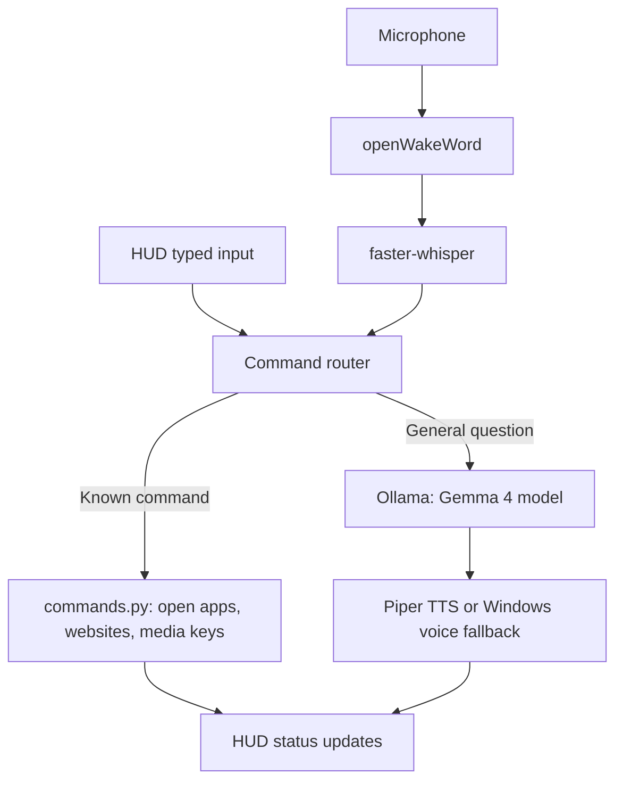

# Architecture

Jarvis separates deterministic commands from conversational responses. The HUD is served over loopback HTTP.

## Source map

- `jarvis.py`: microphone input, voice/audio output, Ollama requests, assistant loop and local HUD HTTP server.
- `commands.py`: rule-based intent matching, app and folder launching, URL validation, media and system controls.
- `ui.html`: standalone HUD layout, client-side events and typed input.
- `commands.example.json`: safe starter shortcuts; user-specific `commands.json` is excluded from version control.

## Local vs. online

Model inference and speech processing are designed to run on the computer after required assets are downloaded. Opening websites, browser searches and installing or upgrading models need a network connection. This architecture has not been validated by a recorded Wi-Fi-off test.

See [Security](SECURITY.md) for threat-model limits and [Installation](INSTALL_WINDOWS.md) for dependencies.
